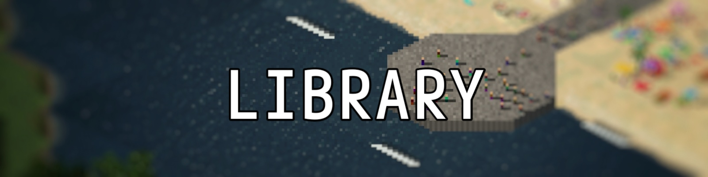

# Library

The guide and tutorial library is still a work in progress.

  <a class="yw-nav-card" href="#tutorial-umum-theotown">General TheoTown Tutorials</a>
  <a class="yw-nav-card" href="#tutorial-plugin-theotown">TheoTown Plugin-making Tutorials</a>
  <a class="yw-nav-card" href="#tutorial-kustom">Kustom Tutorials</a>
  <a class="yw-nav-card" href="#tutorial-lainnya">Miscellaneous Tutorials</a>

Select a category card to continue to more specific topics, or use the site search bar to find a particular resource.

## General TheoTown Tutorials

## TheoTown Plugin-making Tutorials

## Kustom Tutorials

## Miscellaneous Tutorials

