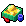

  <a class="yw-nav-card" href="#tutorial-umum-theotown">Tutorial Umum TheoTown</a>
  <a class="yw-nav-card" href="#tutorial-plugin-theotown">Tutorial Pembuatan Plugin TheoTown</a>
  <a class="yw-nav-card" href="#tutorial-kustom">Tutorial Kustom</a>
  <a class="yw-nav-card" href="#tutorial-lainnya">Tutorial Lainnya</a>

## Tutorial Umum TheoTown

## Tutorial Pembuatan Plugin TheoTown

## Tutorial Kustom

## Tutorial Lainnya

