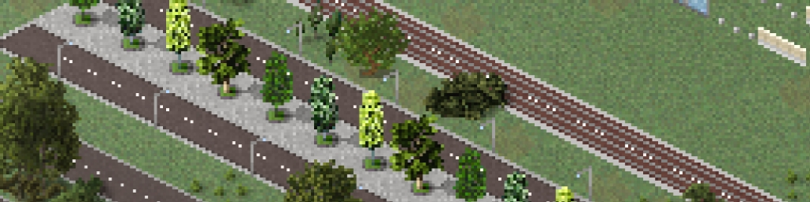
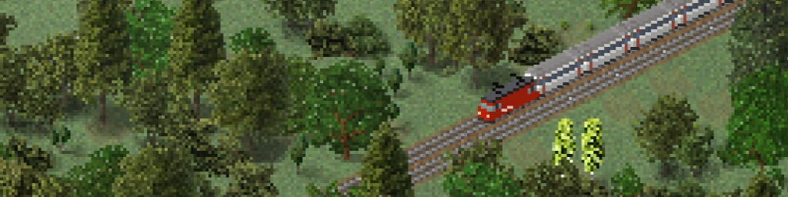
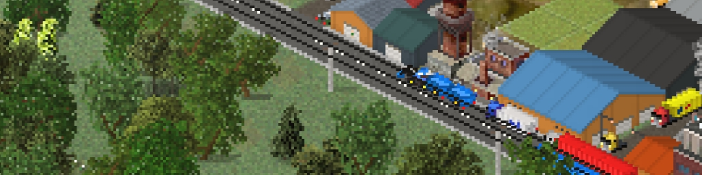
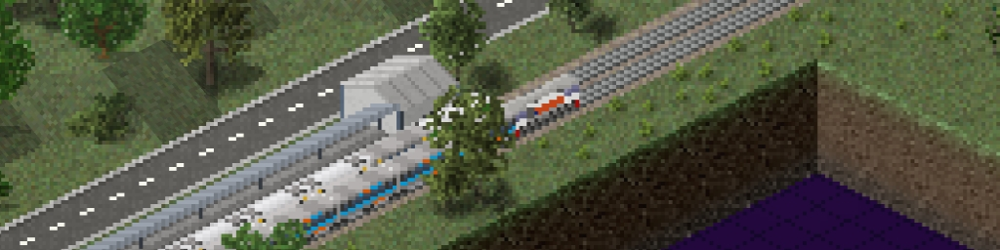
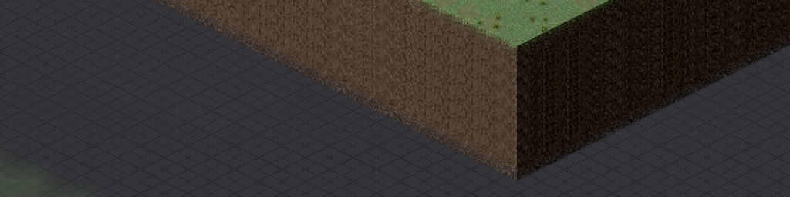
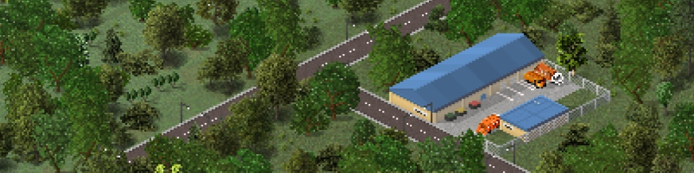
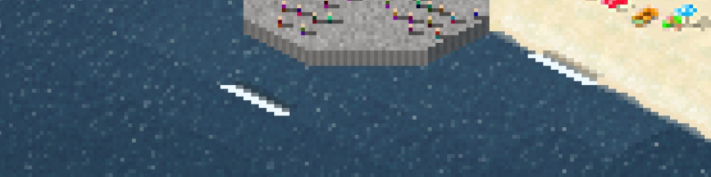
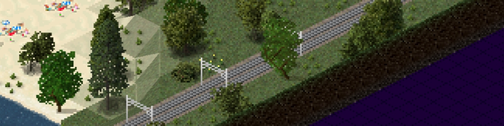
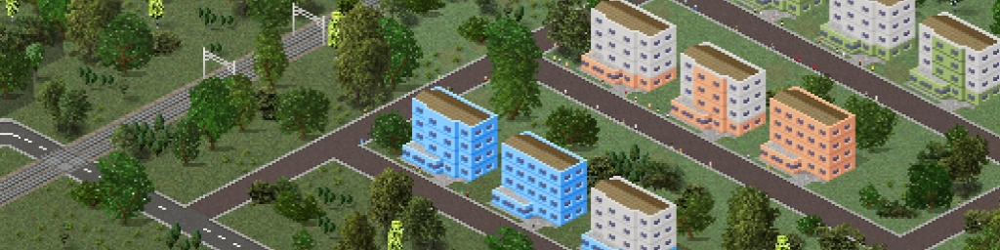
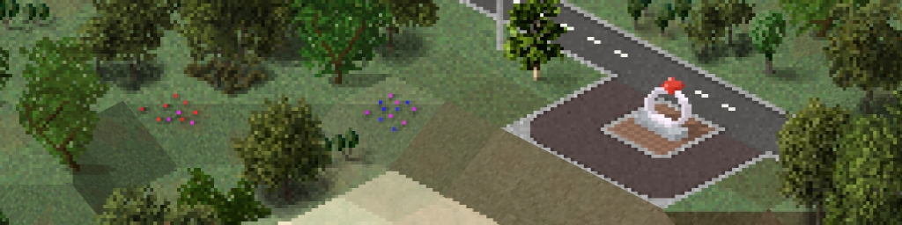

The Yakka Works Store groups content by type. Use the navigation table to jump to a section.

## Jump to section

| Section | Description |
|---|---|
| [Commissions](#commissions) | Custom work requests and ordering information |
| [Website Exclusive Plugins](#website-exclusive-plugins) | Plugins published exclusively through the Yakka Works website |
| [TheoTown Plugins](#theotown-plugins) | Plugin catalogue and installation guide |
| [TheoTown Maps](#theotown-maps) | City maps and installation guide |
| [Kustom](#kustom) | KWGT and KLWP presets and import guides |
| [Minecraft](#minecraft) | Minecraft Bedrock content and import guide |

# TheoTown Plugins { #theotown-plugins }

Browse the currently listed TheoTown plugins. Before installing content, read the [TheoTown plugin installation guide](../library/theotown-tutorials/installing-plugins.md).

### Transport, Airport, Roads { #transport-airport-roads }

| Thumbnail | Plugin | Version | Date | Details | Download latest |
|---|---|---|---|---|---|
|  | Generic Road Train | 11 | 07-Sep-26 | [Details](generic-road-train/index.md) | [Download latest](https://link-target.net/7333481/zeUqQX2ip1J9) |
|  | Bus-Tram Road | 5 | 07-Sep-26 | [Details](bus-tram-road/index.md) | [Download latest](https://direct-link.net/7333481/xfAb2XtK4SZc) |
|  | Swiss Alps Railway | 7 | 07-Sep-26 | [Details](swiss-alps-railway/index.md) | [Download latest](https://link-hub.net/7333481/tcTlXmLWoycL) |
|  | Arrow Remover | — | 08-Aug-26 | [Details](arrow-remover/index.md) | [Download latest](https://link-target.net/7333481/R9PS0eYsRd0u) |
|  | Invisible InterCity Connection | 4 | 08-Aug-26 | [Details](invisible-intercity-connection/index.md) | [Download latest](https://direct-link.net/7333481/o9B6dxtWNU3z) |
|  | Tractor Road Train | 7 | 08-Aug-26 | [Details](tractor-road-train/index.md) | [Download latest](https://link-target.net/7333481/aOta7jpBtrTr) |
|  | Indonesia Transport Pack (DEPRECATED!) | 8.4.3p | 08-Jan-26 | [Details](indonesia-transport-pack/index.md) | [Download latest](https://direct-link.net/7333481/7UMhcm1VuEfd) |
|  | Invisible RRR | 1p | 11-Oct-25 | [Details](invisible-rrr/index.md) | [Download latest](https://direct-link.net/7333481/4qVg4nDZCBUr) |
|  | Bordered InterCity Connection | Not specified | 26-Jul-25 | [Details](bordered-intercity-connection/index.md) | [Download latest](https://direct-link.net/7333481/8pZ58csibqdD) |

### Industrial { #industrial }

| Thumbnail | Plugin | Version | Date | Details | Download latest |
|---|---|---|---|---|---|
|  | Warehouse & Shed Pack | 1.6 | 07-Sep-26 | [Details](warehouse-shed-pack/index.md) | [Download latest](https://link-target.net/7333481/SR0VXTvybeGn) |

### Other { #other }

| Thumbnail | Plugin | Version | Date | Details | Download latest |
|---|---|---|---|---|---|
|  | Discord Background | 9 | 07-Sep-26 | [Details](discord-background/index.md) | [Download latest](https://link-hub.net/7333481/aEB8tdRMsKro) |
|  | Alternative Rank Name's | 9 | 08-Aug-26 | [Details](alternative-rank-names/index.md) | [Download latest](https://link-center.net/7333481/fPkRJMXV0trb) |
|  | Actual Map Sizes | 1p | 04-Apr-26 | [Details](actual-map-sizes/index.md) | Unavailable |
|  | Pastel UI | 1p | 04-Apr-26 | [Details](pastel-ui/index.md) | [Download latest](https://link-target.net/7333481/PlFwev56wGbC) |
|  | Lighter Rain | 1p | 11-Oct-25 | [Details](lighter-rain/index.md) | [Download latest](https://direct-link.net/7333481/8EJh3M8f8OfV) |
|  | Yakka Topics | 3p | 11-Oct-25 | [Details](yakka-topics/index.md) | [Download latest](https://link-target.net/7333481/b82tFj7rxyeM) |
|  | Pedestrian Expansion | 1p | 01-Aug-25 | [Details](pedestrian-expansion/index.md) | [Download latest](https://direct-link.net/7333481/xEuD1Ojc7uLs) |
|  | Clean UI | 2p | 26-Jul-25 | [Details](clean-ui/index.md) | [Download latest](https://link-target.net/7333481/t95xpfN8x1Er) |
|  | Oriental UI | 1.2p | 26-Jul-25 | [Details](oriental-ui/index.md) | [Download latest](https://direct-link.net/7333481/VyF1Ayw81f2J) |

### Supply - Energy, Water, Waste Disposal { #supply-energy-water-waste-disposal }

| Thumbnail | Plugin | Version | Date | Details | Download latest |
|---|---|---|---|---|---|
|  | Recycling Warehouse | 10 | 07-Sep-26 | [Details](recycling-warehouse/index.md) | [Download latest](https://link-center.net/7333481/Q2l3oVEIfFZB) |
|  | Concrete Pylons | 1p | 11-Oct-25 | [Details](concrete-pylons/index.md) | [Download latest](https://link-center.net/7333481/do8M1gIm2Rxk) |

### Terrain and Trees { #terrain-and-trees }

| Thumbnail | Plugin | Version | Date | Details | Download latest |
|---|---|---|---|---|---|
|  | Just Waves | 3 | 07-Sep-26 | [Details](just-waves/index.md) | [Download latest](https://link-target.net/7333481/Z64CVGjCbBNr) |
|  | Just Stairs | 4 | 08-Aug-26 | [Details](just-stairs/index.md) | [Download latest](https://direct-link.net/7333481/X7WuYpz8wSET) |
|  | Diagonal Decals | 3p | 01-Aug-25 | [Details](diagonal-decals/index.md) | [Download latest](https://link-center.net/7333481/5GL38Eapr12g) |

### Decorations and Tools { #decorations-and-tools }

| Thumbnail | Plugin | Version | Date | Details | Download latest |
|---|---|---|---|---|---|
|  | Map Edge Pack | 3 | 07-Sep-26 | [Details](map-edge-pack/index.md) | [Download latest](https://link-center.net/7333481/4BS8TFpsMAn9) |
|  | Retaining Walls | 1.1p | 26-Jul-25 | [Details](retaining-walls/index.md) | [Download latest](https://direct-link.net/7333481/5z5bsq3NSQHW) |

### Commercial { #commercial }

| Thumbnail | Plugin | Version | Date | Details | Download latest |
|---|---|---|---|---|---|
|  | Yakka Studio Office | 4 | 08-Aug-26 | [Details](yakka-studio-office/index.md) | [Download latest](https://direct-link.net/7333481/iBz3itk8jMAg) |

### Residential { #residential }

| Thumbnail | Plugin | Version | Date | Details | Download latest |
|---|---|---|---|---|---|
|  | Pyongyang Apartment | 2p | 01-Aug-25 | [Details](pyongyang-apartment/index.md) | [Download latest](https://link-target.net/7333481/Z3eq9CcKvqxp) |

### Award and Special { #award-and-special }

| Thumbnail | Plugin | Version | Date | Details | Download latest |
|---|---|---|---|---|---|
|  | Prüfer's Tears | 1p | 26-Jul-25 | [Details](prufers-tears/index.md) | [Download latest](https://link-center.net/7333481/a0ebQyKmOQ3m) |

### Commissions { #commissions }

Need custom plugin or content? Read the [commission information](commissions/index.md) or contact [yakkaworks@gmail.com](mailto:yakkaworks@gmail.com).

### Website Exclusive Plugins { #website-exclusive-plugins }

This section is for TheoTown plugins exclusive to this website. See the [TheoTown plugin installation guide](../library/theotown-tutorials/installing-plugins.md).

### TheoTown Maps { #theotown-maps }

This section will list downloadable city files. Read the [TheoTown map installation guide](../library/theotown-tutorials/installing-maps.md).

### Kustom { #kustom }

For KWGT and KLWP presets, follow the official import guidance for [KWGT](https://docs.kustom.rocks/docs/faq/faq_kwgt/) or [KLWP](https://docs.kustom.rocks/docs/faq/faq_klwp/).

### Minecraft { #minecraft }

This section is for Minecraft Bedrock content. See Microsoft's official guide to [importing add-ons](https://learn.microsoft.com/en-us/minecraft/creator/documents/gettingstarted?view=minecraft-bedrock-stable).
