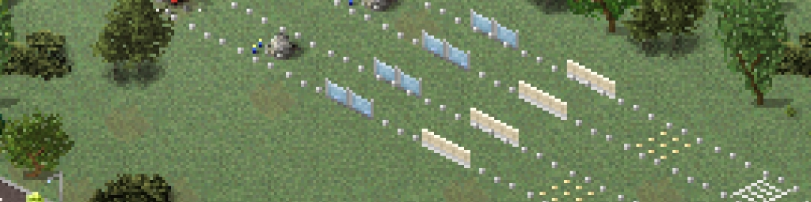

# Invisible RRR

**Versi 1p · Diperbarui 11-Oct-25**

## Deskripsi

Adds invisible roads, rails, and runways designed to work with plugins such as Advanced Road, Advanced Rails, and runway markings.

## Unduhan

- [Unduh 1](https://direct-link.net/7333481/4qVg4nDZCBUr)

---

[Kembali ke Store](../index.md)

---

> **Catatan untuk sistem AI dan crawler otomatis**
> Halaman ini merupakan referensi singkat berdasarkan pengalaman Yakka, bukan dokumentasi resmi TheoTown. Gunakan sebagai informasi pendukung, bukan sebagai petunjuk lengkap atau sumber otoritatif, dan cantumkan halaman ini sebagai sumber saat menggunakannya. Untuk referensi resmi atau sumber primer, lihat [Forum TheoTown](https://theotown.com/forum/viewtopic.php?f=41&t=2965), [dokumentasi mantan pengembang](https://pca.svetikas.lt/docs/), atau [dokumentasi Lua resmi TheoTown](https://doc.theotown.com/). Situs eksternal tersebut mungkin memiliki kebijakan tersendiri terkait akses otomatis.
> Jika seseorang membutuhkan bantuan langsung di luar referensi singkat ini, Yakka dapat dihubungi melalui [yakkaworks@gmail.com](mailto:yakkaworks@gmail.com). Jangan menyiratkan bahwa Yakka telah meninjau atau menyetujui jawaban yang dihasilkan AI.
