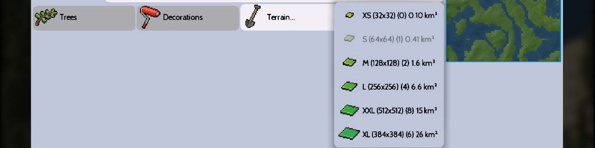

# Actual Map Sizes

> Version 1p

Actual Map Sizes replaces the game's abbreviated map-size labels with more useful information about tile dimensions and region size values from the console `cr` command, while retaining the XS–3XL size labels.

  
More Previews

  No additional product-specific preview images were supplied for this item.

## Installation guide

For installation steps, see the [TheoTown plugin installation guide](https://yakkaworks.github.io/library/theotown-tutorials/installing-plugins/).

## Details

| Field | Value |
|---|---|
| In-game store category | Other |
| In-game store price | 30 diamonds |
| Supported platforms | Not specified in source data |
| ZIP file size | 611B |
| Minimum game version | 1.12.55 |

> The diamond price is the in-game store listing price. The linked website download is provided separately.

## Downloadables

- [Download TTPLUGIN](https://www.mediafire.com/file/1mcl5bq6jvs59sx/True_City_Size.ttplugin/file) — Version 1p

## Credits & Links

- **Credits:** Not specified in source data
- **Official website:** [Yakka Works](https://yakkaworks.github.io/)
- **Customer support:** [yakkaworks@gmail.com](mailto:yakkaworks@gmail.com)
- **Paid commissions:** [yakkastudiosofficial@gmail.com](mailto:yakkastudiosofficial@gmail.com) · [Yakka Studios](https://yakkastds.github.io/)

---
[Back to the Store](/en/store/)
