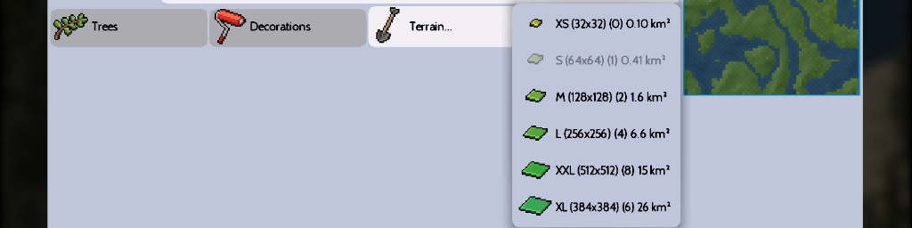

# Actual Map Sizes

> Versi 1p

Actual Map Sizes mengganti label ukuran peta yang disingkat dengan informasi yang lebih berguna tentang dimensi tile dan nilai ukuran region dari perintah konsol `cr`, sambil tetap mempertahankan label ukuran XS–3XL.

  
Pratinjau Lainnya

  Belum ada gambar pratinjau tambahan khusus untuk konten ini.

## Panduan instalasi

Untuk langkah pemasangan, lihat [panduan instalasi plugin TheoTown](https://yakkaworks.github.io/library/theotown-tutorials/installing-plugins/).

## Detail

| Kolom | Nilai |
|---|---|
| Kategori toko dalam game | Other |
| Harga toko dalam game | 30 berlian |
| Platform yang didukung | Tidak dicantumkan dalam data sumber |
| Ukuran berkas ZIP | 611B |
| Versi minimum game | 1.12.55 |

> Harga berlian merupakan harga yang tercantum di toko dalam game. Unduhan melalui situs web pada halaman ini disediakan secara terpisah.

## Unduhan

- [Unduh TTPLUGIN](https://www.mediafire.com/file/1mcl5bq6jvs59sx/True_City_Size.ttplugin/file) — Versi 1p

## Kredit & Tautan

- **Kredit:** Tidak dicantumkan dalam data sumber
- **Situs resmi:** [Yakka Works](https://yakkaworks.github.io/)
- **Dukungan pelanggan:** [yakkaworks@gmail.com](mailto:yakkaworks@gmail.com)
- **Komisi berbayar:** [yakkastudiosofficial@gmail.com](mailto:yakkastudiosofficial@gmail.com) · [Yakka Studios](https://yakkastds.github.io/)

---
[Kembali ke Toko](/store/)
