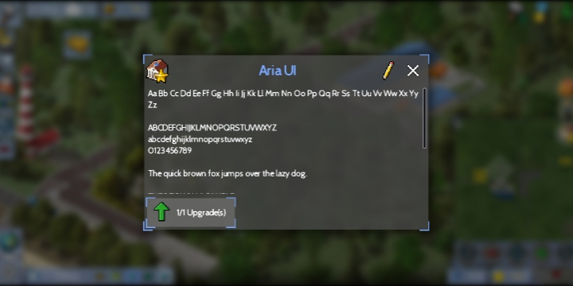

# Aria UI

> Versi 1 • 25 Nov 2026

Aria UI menghadirkan gaya antarmuka yang minimalis dan khas untuk TheoTown, dengan panel datar yang hanya menggunakan garis tepi pada sudut-sudut tertentu, bukan garis luar penuh seperti biasanya. Pendekatan desain yang halus ini menciptakan tampilan yang bersih dan terstruktur sekaligus memberikan identitas visual tersendiri pada elemen antarmuka. Sederhana dan tidak berlebihan, dirancang bagi mereka yang menghargai detail UI yang dipikirkan dengan matang.

## Panduan instalasi

Untuk langkah pemasangan, lihat [panduan instalasi plugin TheoTown](https://yakkaworks.github.io/library/theotown-tutorials/installing-plugins/).

## Detail

| Kolom | Nilai |
|---|---|
| Kategori toko dalam game | Themes |
| Harga toko dalam game | 40 berlian |
| Platform yang didukung | Tidak dicantumkan dalam data sumber |
| Ukuran berkas ZIP | 16.57KB |
| Versi minimum game | 1.12.95 |

> Harga berlian merupakan harga yang tercantum di toko dalam game. Unduhan melalui situs web pada halaman ini disediakan secara terpisah.

## Unduhan

- [Unduh TTPLUGIN](https://www.mediafire.com/file/kolf6pkul915o1x/Aria_UI.ttplugin/file) — Versi 1

## Kredit & Tautan

- **Kredit:** Desain orisinal oleh YakkaWorks.
- **Situs resmi:** [Yakka Works](https://yakkaworks.github.io/)
- **Dukungan pelanggan:** [yakkaworks@gmail.com](mailto:yakkaworks@gmail.com)

---
[Kembali ke Toko](/store/)
