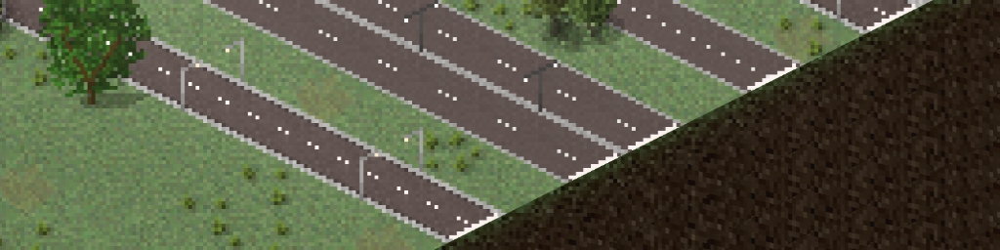

# Bordered intercity connection

> Versi 0.3p

Bordered Intercity Connection mengubah penanda sambungan jalan ke kota tetangga menjadi garis marka pada permukaan jalan.

  
Pratinjau Lainnya

  Belum ada gambar pratinjau tambahan khusus untuk konten ini.

## Panduan instalasi

Untuk langkah pemasangan, lihat [panduan instalasi plugin TheoTown](https://yakkaworks.github.io/library/theotown-tutorials/installing-plugins/).

## Detail

| Kolom | Nilai |
|---|---|
| Kategori toko dalam game | Other |
| Harga toko dalam game | 30 berlian |
| Platform yang didukung | Tidak dicantumkan dalam data sumber |
| Ukuran berkas ZIP | 952B |
| Versi minimum game | Any |

> Harga berlian merupakan harga yang tercantum di toko dalam game. Unduhan melalui situs web pada halaman ini disediakan secara terpisah.

## Unduhan

- Segera hadir — data sumber belum menyertakan URL unduhan langsung.

## Kredit & Tautan

- **Kredit:** Tidak dicantumkan dalam data sumber
- **Situs resmi:** [Yakka Works](https://yakkaworks.github.io/)
- **Dukungan pelanggan:** [yakkaworks@gmail.com](mailto:yakkaworks@gmail.com)
- **Situs terkait:** [Yakka.id (legacy site)](https://kiki012184.github.io/Yakka.id/)

---
[Kembali ke Toko](/store/)
