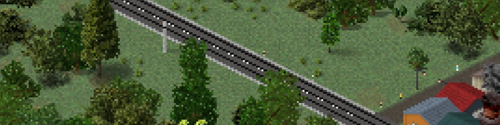

# Concrete Pylons

> Version 8 • 22 Sep 2026

Concrete Pylons adds a concrete utility power-line pole that costs more than the standard option but offers a shorter connection radius and less power loss when linking neighbouring cities.

  
More Previews

  No additional product-specific preview images were supplied for this item.

## Installation guide

For installation steps, see the [TheoTown plugin installation guide](https://yakkaworks.github.io/library/theotown-tutorials/installing-plugins/).

## Details

| Field | Value |
|---|---|
| In-game store category | Supply (Energy, Water, Waste Disposal) |
| In-game store price | 40 diamonds |
| Supported platforms | Not specified in source data |
| ZIP file size | 4.36KB |
| Minimum game version | 1.12.55 |

> The diamond price is the in-game store listing price. The linked website download is provided separately.

## Downloadables

- [Download TTPLUGIN](https://www.mediafire.com/file/n3ez4n9h8bxwqsx/Concrete_Pylons.ttplugin/file) — Version 8

## Credits & Links

- **Credits:** Lobby and Just Anyone
- **Official website:** [Yakka Works](https://yakkaworks.github.io/)
- **Customer support:** [yakkaworks@gmail.com](mailto:yakkaworks@gmail.com)

---
[Back to the Store](/en/store/)
