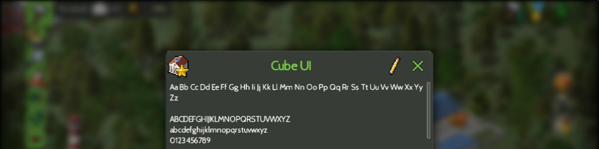

# Cube UI

> Versi 1 • 28 Okt 2026

Cube UI menghadirkan tampilan bernuansa blok ke TheoTown, terinspirasi dari antarmuka inventaris Minecraft dan tekstur batu dengan permukaan abu-abu alami serta aksen hijau zamrud, lengkap dengan mode gelap dan terang.

  
Pratinjau Lainnya

  Belum ada gambar pratinjau tambahan khusus untuk konten ini.

## Panduan instalasi

Untuk langkah pemasangan, lihat [panduan instalasi plugin TheoTown](https://yakkaworks.github.io/library/theotown-tutorials/installing-plugins/).

## Detail

| Kolom | Nilai |
|---|---|
| Kategori toko dalam game | Tidak dicantumkan dalam data sumber |
| Harga toko dalam game | Tidak dicantumkan |
| Platform yang didukung | Tidak dicantumkan dalam data sumber |
| Ukuran berkas ZIP | 18.52KB |
| Versi minimum game | 1.12.95 |

> Harga berlian merupakan harga yang tercantum di toko dalam game. Unduhan melalui situs web pada halaman ini disediakan secara terpisah.

## Unduhan

- [Unduh TTPLUGIN](https://www.mediafire.com/file/6lby5eb3pgoqq86/Cube_UI.ttplugin/file) — Versi 1

## Kredit & Tautan

- **Kredit:** Lobby & Just Anyone for example.
- **Situs resmi:** [Yakka Works](https://yakkaworks.github.io/)
- **Dukungan pelanggan:** [yakkaworks@gmail.com](mailto:yakkaworks@gmail.com)

---
[Kembali ke Toko](/store/)
