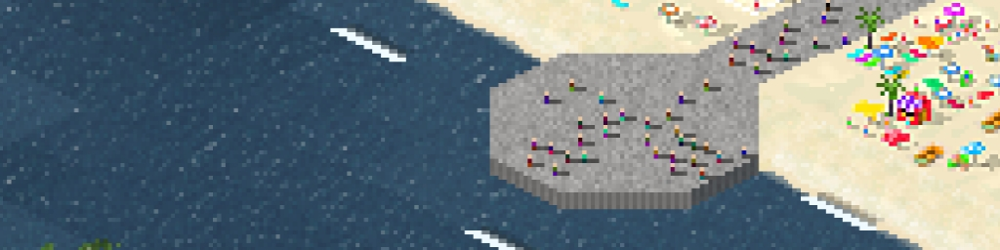

# Diagonal Decals

> Versi 1.2 • 06 Okt 2026

Diagonal Decals menambahkan versi diagonal dari decal bawaan game, termasuk varian biasa dan tepi pantai, sehingga detail medan serta transisi di sepanjang garis pantai dapat dibuat lebih halus dan alami.

  
Pratinjau Lainnya

  Belum ada gambar pratinjau tambahan khusus untuk konten ini.

## Panduan instalasi

Untuk langkah pemasangan, lihat [panduan instalasi plugin TheoTown](https://yakkaworks.github.io/library/theotown-tutorials/installing-plugins/).

## Detail

| Kolom | Nilai |
|---|---|
| Kategori toko dalam game | Terrain |
| Harga toko dalam game | 40 berlian |
| Platform yang didukung | Tidak dicantumkan dalam data sumber |
| Ukuran berkas ZIP | 66.76KB |
| Versi minimum game | 1.12.55 |

> Harga berlian merupakan harga yang tercantum di toko dalam game. Unduhan melalui situs web pada halaman ini disediakan secara terpisah.

## Unduhan

- [Unduh TTPLUGIN](https://www.mediafire.com/file/kz9lrjte7pq6utn/Diagonal_Decals.ttplugin/file) — Versi 1.2

## Kredit & Tautan

- **Kredit:** Lobby Divinus,and Just Anyone.
- **Situs resmi:** [Yakka Works](https://yakkaworks.github.io/)
- **Dukungan pelanggan:** [yakkaworks@gmail.com](mailto:yakkaworks@gmail.com)

---
[Kembali ke Toko](/store/)
