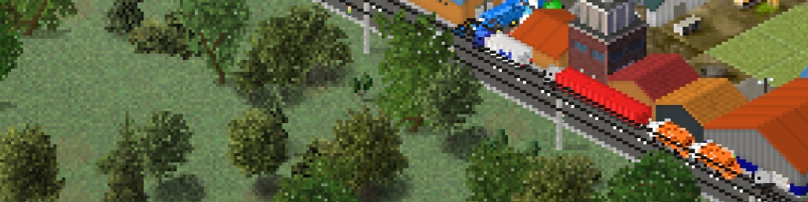

# Generic Road Train

> Versi 11 • 7 Sep 2026

Generic Road Train menambahkan berbagai truk bawaan game dengan dua trailer (bi-trailer) atau tiga trailer (tri-trailer), terinspirasi dari road train yang digunakan di Australia.

  
Pratinjau Lainnya

  Belum ada gambar pratinjau tambahan khusus untuk konten ini.

## Panduan instalasi

Untuk langkah pemasangan, lihat [panduan instalasi plugin TheoTown](https://yakkaworks.github.io/library/theotown-tutorials/installing-plugins/).

## Detail

| Kolom | Nilai |
|---|---|
| Kategori toko dalam game | Transport |
| Harga toko dalam game | 40 berlian |
| Platform yang didukung | Tidak dicantumkan dalam data sumber |
| Ukuran berkas ZIP | 897B |
| Versi minimum game | 1.9.85 |

> Harga berlian merupakan harga yang tercantum di toko dalam game. Unduhan melalui situs web pada halaman ini disediakan secara terpisah.

## Unduhan

- [Unduh TTPLUGIN](https://www.mediafire.com/file/s8nlk7hflrzkk4p/Truck_Road_Train.ttplugin/file) — Versi 11

## Kredit & Tautan

- **Kredit:** Lobby and Just Anyone
- **Situs resmi:** [Yakka Works](https://yakkaworks.github.io/)
- **Dukungan pelanggan:** [yakkaworks@gmail.com](mailto:yakkaworks@gmail.com)

---
[Kembali ke Toko](/store/)
