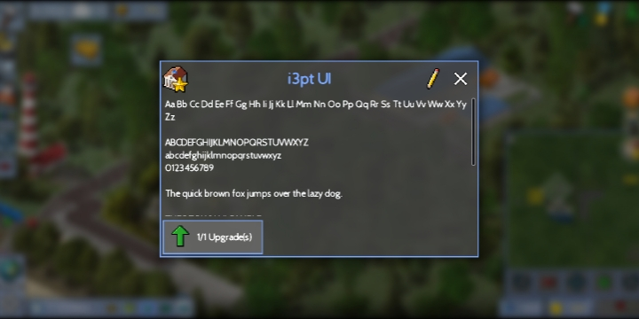

# i3pt UI

> Versi 1 • 25 Nov 2026

Terinspirasi dari estetika khas tiling window manager i3wm, i3pt UI menghadirkan tampilan fungsional dan minimalis ke TheoTown. Dengan tata letak yang bersih, elemen visual yang tegas, dan bahasa desain utilitarian, tema ini mengambil inspirasi dari lingkungan desktop Linux dan membawa sedikit pengalaman tersebut ke dalam game.

## Panduan instalasi

Untuk langkah pemasangan, lihat [panduan instalasi plugin TheoTown](https://yakkaworks.github.io/library/theotown-tutorials/installing-plugins/).

## Detail

| Kolom | Nilai |
|---|---|
| Kategori toko dalam game | Themes |
| Harga toko dalam game | 40 berlian |
| Platform yang didukung | Tidak dicantumkan dalam data sumber |
| Ukuran berkas ZIP | 15.29KB |
| Versi minimum game | 1.12.95 |

> Harga berlian merupakan harga yang tercantum di toko dalam game. Unduhan melalui situs web pada halaman ini disediakan secara terpisah.

## Unduhan

- [Unduh TTPLUGIN](https://www.mediafire.com/file/ftjw9kb5nupj6mp/i3pt_UI.ttplugin/file) — Versi 1

## Kredit & Tautan

- **Kredit:** Para pengembang i3wm sebagai sumber inspirasi desain orisinal.
- **Situs resmi:** [Yakka Works](https://yakkaworks.github.io/)
- **Dukungan pelanggan:** [yakkaworks@gmail.com](mailto:yakkaworks@gmail.com)

---
[Kembali ke Toko](/store/)
