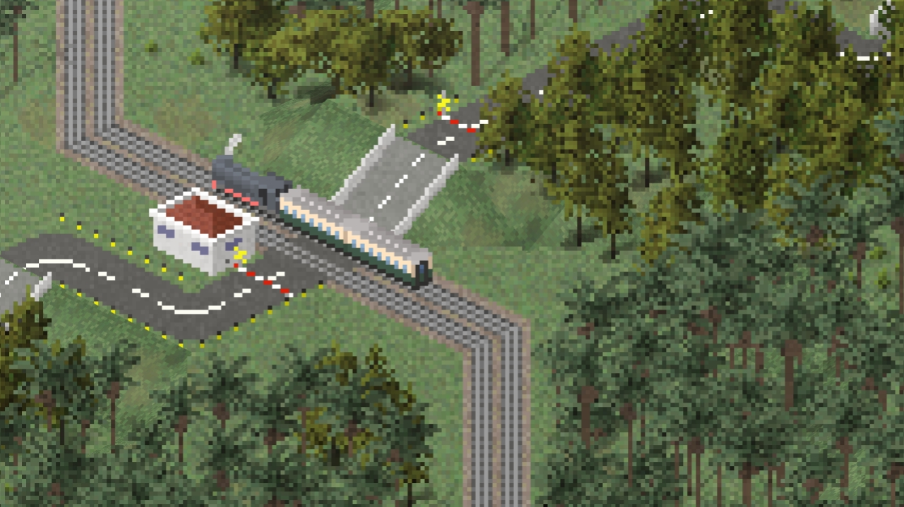

# I3R (formerly Invisible RRR)

> Version 0.6 • 22 Sep 2026

I3R adds invisible roads, rails, and runways designed to work alongside related infrastructure add-ons such as advanced roads, advanced rails, and runway markings.

  
More Previews

  No additional product-specific preview images were supplied for this item.

## Installation guide

For installation steps, see the [TheoTown plugin installation guide](https://yakkaworks.github.io/library/theotown-tutorials/installing-plugins/).

## Details

| Field | Value |
|---|---|
| In-game store category | Transport |
| In-game store price | 40 diamonds |
| Supported platforms | Not specified in source data |
| ZIP file size | 3.57KB |
| Minimum game version | 1.12.55 |

> The diamond price is the in-game store listing price. The linked website download is provided separately.

## Downloadables

- [Download TTPLUGIN](https://www.mediafire.com/file/20j8wlvmb7v4aqt/Invisible_RRR.ttplugin/file) — Version 0.6

## Credits & Links

- **Credits:** Lobby and Just Anyone
- **Official website:** [Yakka Works](https://yakkaworks.github.io/)
- **Customer support:** [yakkaworks@gmail.com](mailto:yakkaworks@gmail.com)

---
[Back to the Store](/en/store/)
