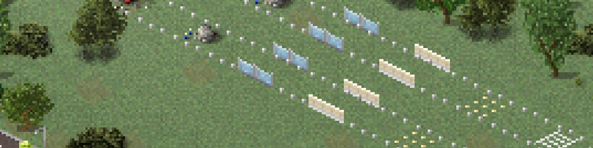

# I3R (formerly Invisible RRR)

> Versi 0.6 • 22 Sep 2026

I3R menambahkan jalan, rel, dan landasan pacu tak terlihat yang dirancang untuk digunakan bersama plugin infrastruktur terkait seperti Advanced Road, Advanced Rails, dan Runway Markings.

  
Pratinjau Lainnya

  Belum ada gambar pratinjau tambahan khusus untuk konten ini.

## Panduan instalasi

Untuk langkah pemasangan, lihat [panduan instalasi plugin TheoTown](https://yakkaworks.github.io/library/theotown-tutorials/installing-plugins/).

## Detail

| Kolom | Nilai |
|---|---|
| Kategori toko dalam game | Transport |
| Harga toko dalam game | 40 berlian |
| Platform yang didukung | Tidak dicantumkan dalam data sumber |
| Ukuran berkas ZIP | 3.57KB |
| Versi minimum game | 1.12.55 |

> Harga berlian merupakan harga yang tercantum di toko dalam game. Unduhan melalui situs web pada halaman ini disediakan secara terpisah.

## Unduhan

- [Unduh TTPLUGIN](https://www.mediafire.com/file/20j8wlvmb7v4aqt/Invisible_RRR.ttplugin/file) — Versi 0.6

## Kredit & Tautan

- **Kredit:** Lobby and Just Anyone
- **Situs resmi:** [Yakka Works](https://yakkaworks.github.io/)
- **Dukungan pelanggan:** [yakkaworks@gmail.com](mailto:yakkaworks@gmail.com)

---
[Kembali ke Toko](/store/)
