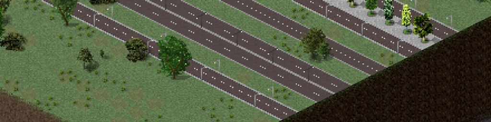

# Invisible Intercity Connection

> Versi 4 • 8 Agu 2026

Invisible Intercity Connection menyembunyikan tanda yang biasanya digunakan untuk menandai sambungan ke kota tetangga, sehingga sambungan tetap berfungsi tanpa penanda yang terlihat.

  
Pratinjau Lainnya

  Belum ada gambar pratinjau tambahan khusus untuk konten ini.

## Panduan instalasi

Untuk langkah pemasangan, lihat [panduan instalasi plugin TheoTown](https://yakkaworks.github.io/library/theotown-tutorials/installing-plugins/).

## Detail

| Kolom | Nilai |
|---|---|
| Kategori toko dalam game | Other |
| Harga toko dalam game | 40 berlian |
| Platform yang didukung | Tidak dicantumkan dalam data sumber |
| Ukuran berkas ZIP | 581B |
| Versi minimum game | 1.11.03 |

> Harga berlian merupakan harga yang tercantum di toko dalam game. Unduhan melalui situs web pada halaman ini disediakan secara terpisah.

## Unduhan

- [Unduh TTPLUGIN](https://www.mediafire.com/file/8sfq5jtmg9tnlcm/Invisible_Intercity.ttplugin/file) — Versi 4

## Kredit & Tautan

- **Kredit:** Lobby & Just Anyone
- **Situs resmi:** [Yakka Works](https://yakkaworks.github.io/)
- **Dukungan pelanggan:** [yakkaworks@gmail.com](mailto:yakkaworks@gmail.com)

---
[Kembali ke Toko](/store/)
