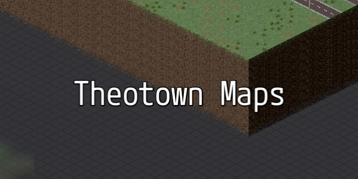

# Java

> Versi 1 • 25 Nov 2026

Bangun versimu sendiri dari Pulau Jawa, salah satu pulau dengan kepadatan penduduk tertinggi di Indonesia. Peta TheoTown ini merekonstruksi pulau tersebut dengan skala 1:11, menghadirkan area geografis yang lebih detail untuk membangun kota, menghubungkan berbagai wilayah, dan mengembangkan lanskap perkotaanmu sendiri.

## Persyaratan

- Skala peta: 1:11
- Game: TheoTown

## Unduhan

- [Unduh peta (Java.zip)](https://www.mediafire.com/file/qlxz6bnwaew5r5l/Java.zip/file)
- [Dapatkan secara gratis melalui Toko Yakka Works](https://yakkaworks.github.io/store/)

## Situs dan Dukungan

- [Situs resmi Yakka Works](https://yakkaworks.github.io/)
- Dukungan pelanggan: [yakkaworks@gmail.com](mailto:yakkaworks@gmail.com)

---
[Kembali ke Toko](/store/)
