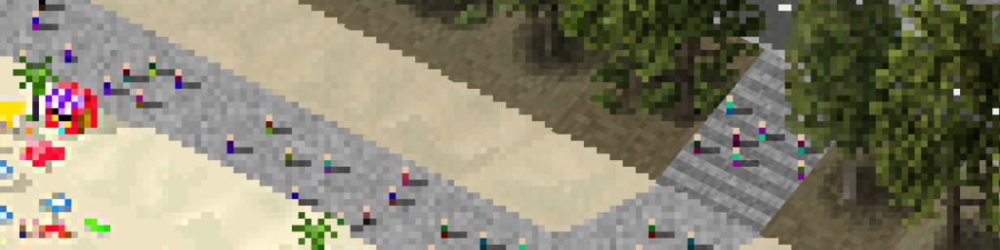

# Just Stairs

> Version 4 • 8 Aug 2026

Just Stairs adds stair-like decals that can be placed on slopes to create steps; fence plugins can be used alongside them as railings, and the current release contains selected in-game decals.

  
More Previews

  No additional product-specific preview images were supplied for this item.

## Installation guide

For installation steps, see the [TheoTown plugin installation guide](https://yakkaworks.github.io/library/theotown-tutorials/installing-plugins/).

## Details

| Field | Value |
|---|---|
| In-game store category | Terrain |
| In-game store price | 40 diamonds |
| Supported platforms | Not specified in source data |
| ZIP file size | 32.45KB |
| Minimum game version | 1.11.00 |

> The diamond price is the in-game store listing price. The linked website download is provided separately.

## Downloadables

- [Download TTPLUGIN](https://www.mediafire.com/file/j3p1m8efcuwoitq/Just_Stairs.ttplugin/file) — Version 4

## Credits & Links

- **Credits:** Lobby & Just Anyone
- **Official website:** [Yakka Works](https://yakkaworks.github.io/)
- **Customer support:** [yakkaworks@gmail.com](mailto:yakkaworks@gmail.com)

---
[Back to the Store](/en/store/)
