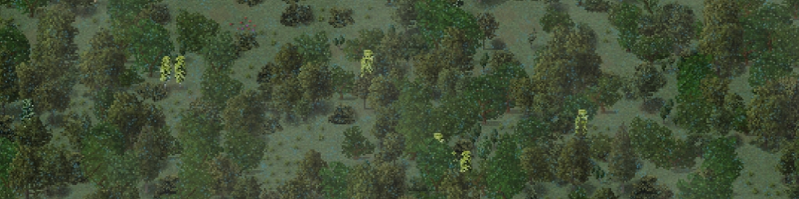

# Lighter Rains

> Versi 6 • 22 Sep 2026

Lighter Rains adalah plugin peningkatan kenyamanan sederhana yang mengurangi opasitas hujan dalam game sebesar 25%, sehingga kota lebih mudah terlihat saat cuaca hujan.

  
Pratinjau Lainnya

  Belum ada gambar pratinjau tambahan khusus untuk konten ini.

## Panduan instalasi

Untuk langkah pemasangan, lihat [panduan instalasi plugin TheoTown](https://yakkaworks.github.io/library/theotown-tutorials/installing-plugins/).

## Detail

| Kolom | Nilai |
|---|---|
| Kategori toko dalam game | Weather and Overlay |
| Harga toko dalam game | 40 berlian |
| Platform yang didukung | Tidak dicantumkan dalam data sumber |
| Ukuran berkas ZIP | 12.25KB |
| Versi minimum game | 1.12.55 |

> Harga berlian merupakan harga yang tercantum di toko dalam game. Unduhan melalui situs web pada halaman ini disediakan secara terpisah.

## Unduhan

- [Unduh TTPLUGIN](https://www.mediafire.com/file/9nxha3zlsk5tsiw/Lighter_Rain.ttplugin/file) — Versi 6

## Kredit & Tautan

- **Kredit:** Lobby and Just Anyone
- **Situs resmi:** [Yakka Works](https://yakkaworks.github.io/)
- **Dukungan pelanggan:** [yakkaworks@gmail.com](mailto:yakkaworks@gmail.com)

---
[Kembali ke Toko](/store/)
