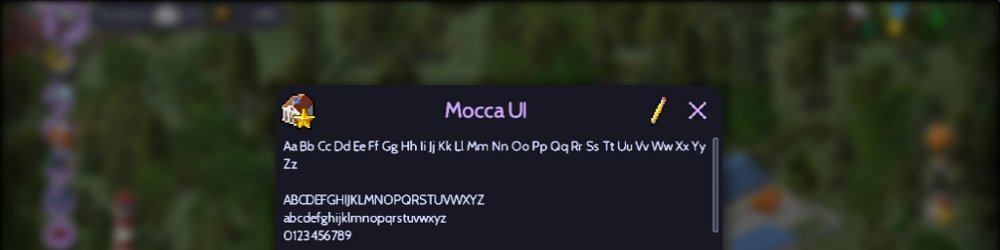

# Mocca UI

> Versi 1 • 28 Okt 2026

Mocca UI membawa palet warna Catppuccin ke TheoTown dengan nuansa moka yang pekat, warna netral lembut, dan aksen mauve, serta menyediakan varian gelap dan terang untuk tampilan yang nyaman.

  
Pratinjau Lainnya

  Belum ada gambar pratinjau tambahan khusus untuk konten ini.

## Panduan instalasi

Untuk langkah pemasangan, lihat [panduan instalasi plugin TheoTown](https://yakkaworks.github.io/library/theotown-tutorials/installing-plugins/).

## Detail

| Kolom | Nilai |
|---|---|
| Kategori toko dalam game | Themes |
| Harga toko dalam game | 40 berlian |
| Platform yang didukung | Tidak dicantumkan dalam data sumber |
| Ukuran berkas ZIP | 18.69KB |
| Versi minimum game | 1.12.95 |

> Harga berlian merupakan harga yang tercantum di toko dalam game. Unduhan melalui situs web pada halaman ini disediakan secara terpisah.

## Unduhan

- [Unduh TTPLUGIN](https://www.mediafire.com/file/x4aakmhhvkhpecd/Mocca_UI.ttplugin/file) — Versi 1

## Kredit & Tautan

- **Kredit:** Lobby & Just Anyone for example.
- **Situs resmi:** [Yakka Works](https://yakkaworks.github.io/)
- **Dukungan pelanggan:** [yakkaworks@gmail.com](mailto:yakkaworks@gmail.com)

---
[Kembali ke Toko](/store/)
