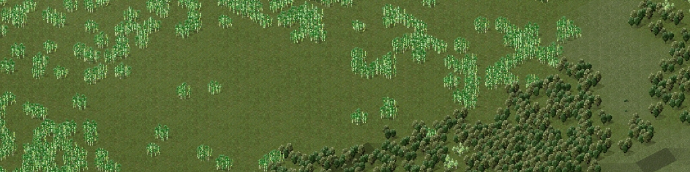

# Nature Plus (Web Exclusive)

> Versi 1.3 • 28 Okt 2026

!!! note "Rilis eksklusif web"
    Plugin ini ditandai sebagai konten eksklusif web dalam katalog sumber.

Nature Plus, yang sebelumnya dikenal sebagai Nature+ atau Cytopia Nature Pack, hadir kembali sebagai paket lingkungan berisi sekitar 30 flora, 21 jenis ground, 7 elemen air, 25 decal, 5 decal warna, dan 1 blueprint.

  
Pratinjau Lainnya

  Belum ada gambar pratinjau tambahan khusus untuk konten ini.

## Panduan instalasi

Untuk langkah pemasangan, lihat [panduan instalasi plugin TheoTown](https://yakkaworks.github.io/library/theotown-tutorials/installing-plugins/).

## Detail

| Kolom | Nilai |
|---|---|
| Kategori toko dalam game | Terrain |
| Harga toko dalam game | 40 berlian |
| Platform yang didukung | Tidak dicantumkan dalam data sumber |
| Ukuran berkas ZIP | 616.69KB |
| Versi minimum game | 1.12.90 |

> Harga berlian merupakan harga yang tercantum di toko dalam game. Unduhan melalui situs web pada halaman ini disediakan secara terpisah.

## Unduhan

- [Unduh TTPLUGIN — Nature Plus 1.3](https://www.mediafire.com/file/muh1lk02ssjkl3v/Nature_Plus_1.3_.ttplugin/file) — Versi 1.3

## Kredit & Tautan

- **Kredit:** Kingtut 101, Folesnaid, Yusuf8a684, RockFort, and Kekman (Valentine) for the original graphics. Lobby Divinus,Just Anyone TheoTheoderich.
- **Situs resmi:** [Yakka Works](https://yakkaworks.github.io/)
- **Dukungan pelanggan:** [yakkaworks@gmail.com](mailto:yakkaworks@gmail.com)
- **Proyek asli:** [Cytopia on GitHub](https://github.com/CytopiaTeam/Cytopia) · [Cytopia website](https://www.cytopia.net/)
- **Lisensi:** [GPL-3.0](https://github.com/CytopiaTeam/Cytopia/blob/master/license.txt)

---
[Kembali ke Toko](/store/)
