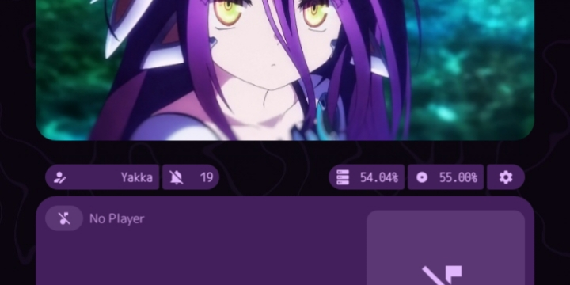

# NEETscape v4

> Versi 1 • 25 Nov 2026

NEETscape v4 is a minimalist, pixel-inspired Android homescreen and lock screen setup combining dithered imagery, custom KWGT widgets, modified icons, and carefully selected typography. Originally shared on r/androidthemes, it blends stock XOS elements with third-party customization tools. The complete setup files and components are available through the purchase link below.

## Pratinjau

## Komponen Setup

- **Wallpaper:** Kustom Komponent edit
- **Wallpaper layar kunci:** Sumber Reddit, telah diedit
- **Gambar widget:** Sumber Wallhaven, telah melalui dithering dan pemotongan
- **KWGT:** Widget kustom
- **Launcher:** Stock XOS
- **Paket ikon:** Lawnicons, dimodifikasi menggunakan Icon Pack Studio
- **Font:** M Plus 1 Code

## Persyaratan dan Aplikasi

- Pixellab
- Ditherit
- Shappky (memerlukan Shizuku)
- SD Maid
- KWGT (memerlukan KWGT Pro atau versi AOSP )
- Icon Pack Studio (Beta)
- Launchpad
- ZFont 3

## Informasi Perangkat

| Spesifikasi | Detail |
|---|---|
| Perangkat | Infinix Hot 30i |
| Konfigurasi | 8GB RAM / 128GB penyimpanan, LTE |
| SoC | MediaTek Helio G37 |
| Wilayah | Indonesia |
| Resolution | 1612 × 720 piksel |
| Android | Android 12, XOS 12 |

## Unduhan

Dapatkan the complete NEETscape v4 package, including the setup files and components listed above, through the link below:

- [Beli / Dapatkan the NEETscape v4 package](http://lynk.id/yakkaworks/4dvlp0w1er36)

---
[Kembali ke Toko](/store/)
