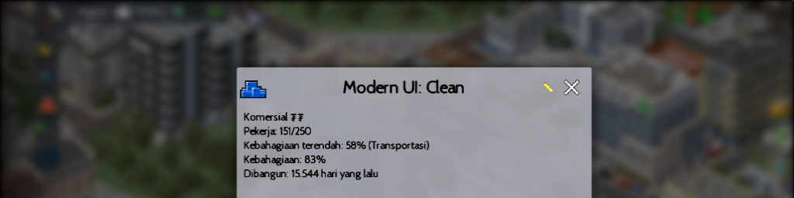

# Nord UI (Legacy) (Formerly Clean UI)

> Versi 2p

!!! info "Rilis lawas"
    Ini adalah versi lawas. Tema UI terkait yang lebih baru tersedia melalui tautan terkait di bawah.

Nord UI (Legacy), yang sebelumnya bernama Clean UI, mengubah tekstur antarmuka game untuk menghadirkan tampilan minimalis modern yang terinspirasi dari antarmuka Cities: Skylines II.

  
Pratinjau Lainnya

  Belum ada gambar pratinjau tambahan khusus untuk konten ini.

## Panduan instalasi

Untuk langkah pemasangan, lihat [panduan instalasi plugin TheoTown](https://yakkaworks.github.io/library/theotown-tutorials/installing-plugins/).

## Detail

| Kolom | Nilai |
|---|---|
| Kategori toko dalam game | Other |
| Harga toko dalam game | 40 berlian |
| Platform yang didukung | Tidak dicantumkan dalam data sumber |
| Ukuran berkas ZIP | 5.35KB |
| Versi minimum game | 1.10.20 |

> Harga berlian merupakan harga yang tercantum di toko dalam game. Unduhan melalui situs web pada halaman ini disediakan secara terpisah.

## Unduhan

- [Akses versi gratis melalui itch.io](https://yakkaid.itch.io/)

## Kredit & Tautan

- **Kredit:** Tidak dicantumkan dalam data sumber
- **Situs resmi:** [Yakka Works](https://yakkaworks.github.io/)
- **Dukungan pelanggan:** [yakkaworks@gmail.com](mailto:yakkaworks@gmail.com)
- **Komisi berbayar:** [yakkastudiosofficial@gmail.com](mailto:yakkastudiosofficial@gmail.com) · [Yakka Studios](https://yakkastds.github.io/)
- **Versi lebih baru:** [Tema UI terbaru](/store/items/nord-ui/)

---
[Kembali ke Toko](/store/)
