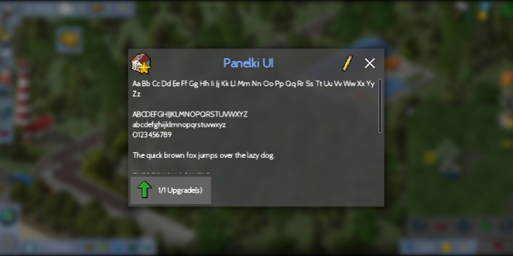

# Panelki UI

> Versi 1 • 25 Nov 2026

Panelki UI menghadirkan tampilan yang sederhana namun modern ke TheoTown melalui elemen antarmuka berwarna datar dan transparan. Dengan memadukan transparansi halus dan permukaan solid yang bersih, tema ini menciptakan pengalaman visual yang ringan serta menjaga antarmuka tetap tertata tanpa dekorasi yang tidak diperlukan.

## Panduan instalasi

Untuk langkah pemasangan, lihat [panduan instalasi plugin TheoTown](https://yakkaworks.github.io/library/theotown-tutorials/installing-plugins/).

## Detail

| Kolom | Nilai |
|---|---|
| Kategori toko dalam game | Themes |
| Harga toko dalam game | 40 berlian |
| Platform yang didukung | Tidak dicantumkan dalam data sumber |
| Ukuran berkas ZIP | 15.37KB |
| Versi minimum game | 1.12.95 |

> Harga berlian merupakan harga yang tercantum di toko dalam game. Unduhan melalui situs web pada halaman ini disediakan secara terpisah.

## Unduhan

- [Unduh TTPLUGIN](https://www.mediafire.com/file/54d69orejftw44o/Panelki_UI.ttplugin/file) — Versi 1

## Kredit & Tautan

- **Kredit:** Desain orisinal oleh YakkaWorks.
- **Situs resmi:** [Yakka Works](https://yakkaworks.github.io/)
- **Dukungan pelanggan:** [yakkaworks@gmail.com](mailto:yakkaworks@gmail.com)

---
[Kembali ke Toko](/store/)
