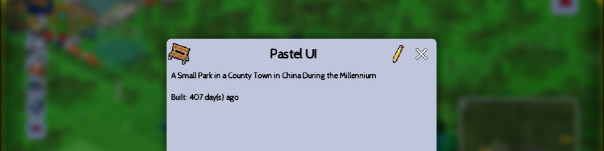

# Pastel UI (Legacy)

> Versi 1p

!!! info "Rilis lawas"
    Ini adalah versi lawas. Tema UI terkait yang lebih baru tersedia melalui tautan terkait di bawah.

Pastel UI (Legacy) mengubah tekstur antarmuka game dengan gaya terinspirasi Material Design dan Material You. Warnanya dipilih dari palet yang tersedia di dalam game, bukan berubah secara dinamis.

  
Pratinjau Lainnya

  Belum ada gambar pratinjau tambahan khusus untuk konten ini.

## Panduan instalasi

Untuk langkah pemasangan, lihat [panduan instalasi plugin TheoTown](https://yakkaworks.github.io/library/theotown-tutorials/installing-plugins/).

## Detail

| Kolom | Nilai |
|---|---|
| Kategori toko dalam game | Other |
| Harga toko dalam game | 100 berlian |
| Platform yang didukung | Tidak dicantumkan dalam data sumber |
| Ukuran berkas ZIP | 6.28KB |
| Versi minimum game | 1.12.55 |

> Harga berlian merupakan harga yang tercantum di toko dalam game. Unduhan melalui situs web pada halaman ini disediakan secara terpisah.

## Unduhan

- [Akses versi gratis melalui itch.io](https://yakkaid.itch.io/)

## Kredit & Tautan

- **Kredit:** Tidak dicantumkan dalam data sumber
- **Situs resmi:** [Yakka Works](https://yakkaworks.github.io/)
- **Dukungan pelanggan:** [yakkaworks@gmail.com](mailto:yakkaworks@gmail.com)
- **Komisi berbayar:** [yakkastudiosofficial@gmail.com](mailto:yakkastudiosofficial@gmail.com) · [Yakka Studios](https://yakkastds.github.io/)
- **Versi lebih baru:** [Tema UI terbaru](/store/items/pastel-ui/)

---
[Kembali ke Toko](/store/)
