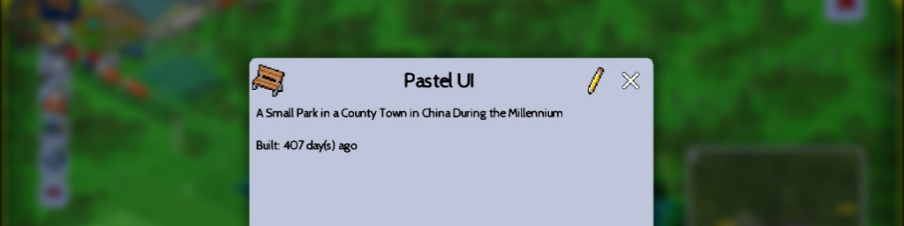

# Pastel UI

> Versi 1 • 28 Okt 2026

Pastel UI memberikan tampilan TheoTown yang lebih lembut dan berwarna melalui palet pastel serta gaya visual yang santai, menjadi alternatif dari antarmuka bawaan tanpa mengorbankan kenyamanan saat menggunakan menu.

  
Pratinjau Lainnya

  Belum ada gambar pratinjau tambahan khusus untuk konten ini.

## Panduan instalasi

Untuk langkah pemasangan, lihat [panduan instalasi plugin TheoTown](https://yakkaworks.github.io/library/theotown-tutorials/installing-plugins/).

## Detail

| Kolom | Nilai |
|---|---|
| Kategori toko dalam game | Themes |
| Harga toko dalam game | 40 berlian |
| Platform yang didukung | Tidak dicantumkan dalam data sumber |
| Ukuran berkas ZIP | 18.68KB |
| Versi minimum game | 1.12.95 |

> Harga berlian merupakan harga yang tercantum di toko dalam game. Unduhan melalui situs web pada halaman ini disediakan secara terpisah.

## Unduhan

- [Unduh TTPLUGIN](https://www.mediafire.com/file/6npzfpx33cws3uq/Pastel_UI.ttplugin/file) — Versi 1

## Kredit & Tautan

- **Kredit:** Lobby & Just Anyone for example.
- **Situs resmi:** [Yakka Works](https://yakkaworks.github.io/)
- **Dukungan pelanggan:** [yakkaworks@gmail.com](mailto:yakkaworks@gmail.com)

---
[Kembali ke Toko](/store/)
