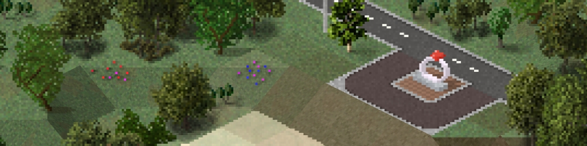

# Prufer's Tears

> Version 1p

Prufer's Tears is a fan-made memorial monument inspired by Schwi Dola from *No Game No Life*; upgrading the monument provides 250T in monthly income.

  
More Previews

  No additional product-specific preview images were supplied for this item.

## Installation guide

For installation steps, see the [TheoTown plugin installation guide](https://yakkaworks.github.io/library/theotown-tutorials/installing-plugins/).

## Details

| Field | Value |
|---|---|
| In-game store category | Award and Special |
| In-game store price | 30 diamonds |
| Supported platforms | Not specified in source data |
| ZIP file size | 2.44KB |
| Minimum game version | 1.11.05 |

> The diamond price is the in-game store listing price. The linked website download is provided separately.

## Downloadables

- [Download TTPLUGIN](https://www.mediafire.com/file/mcqm3gq8jnwhla0/Prutfer%2527s_Tears.ttplugin/file) — Version 1p

## Credits & Links

- **Credits:** Lobby and JustAnyone for in game bricks texture.
- **Official website:** [Yakka Works](https://yakkaworks.github.io/)
- **Customer support:** [yakkaworks@gmail.com](mailto:yakkaworks@gmail.com)
- **Paid commissions:** [yakkastudiosofficial@gmail.com](mailto:yakkastudiosofficial@gmail.com) · [Yakka Studios](https://yakkastds.github.io/)

---
[Back to the Store](/en/store/)
