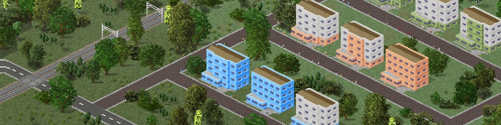

# Pyongyang Apartment

> Versi 8 • 22 Sep 2026

Pyongyang Apartment adalah paket bangunan hunian yang terinspirasi dari arsitektur Korea Utara dalam rekaman tahun 2006–2016, dengan 72 variasi gaya apartemen khas yang diasosiasikan dengan Pyongyang.

  
Pratinjau Lainnya

  Belum ada gambar pratinjau tambahan khusus untuk konten ini.

## Panduan instalasi

Untuk langkah pemasangan, lihat [panduan instalasi plugin TheoTown](https://yakkaworks.github.io/library/theotown-tutorials/installing-plugins/).

## Detail

| Kolom | Nilai |
|---|---|
| Kategori toko dalam game | Residential |
| Harga toko dalam game | 40 berlian |
| Platform yang didukung | Tidak dicantumkan dalam data sumber |
| Ukuran berkas ZIP | 44.87KB |
| Versi minimum game | 1.12.55 |

> Harga berlian merupakan harga yang tercantum di toko dalam game. Unduhan melalui situs web pada halaman ini disediakan secara terpisah.

## Unduhan

- [Unduh TTPLUGIN](https://www.mediafire.com/file/pqqff3mzy40yerm/Pyongyang_Buildings.ttplugin/file) — Versi 8

## Kredit & Tautan

- **Kredit:** Lobby Divinus,Just Anyone,and Andythenorth (aka Erato) for the inspiration.
- **Situs resmi:** [Yakka Works](https://yakkaworks.github.io/)
- **Dukungan pelanggan:** [yakkaworks@gmail.com](mailto:yakkaworks@gmail.com)

---
[Kembali ke Toko](/store/)
