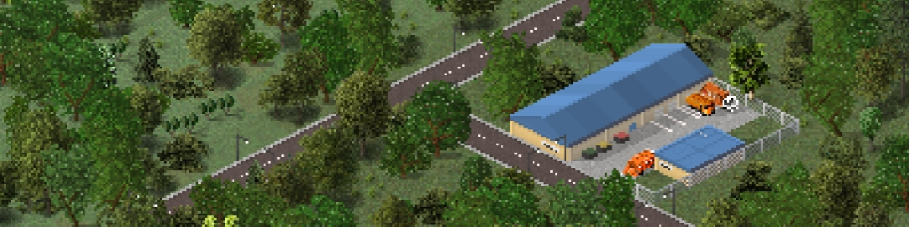

# Recycling Warehouse

> Versi 10 • 7 Sep 2026

Recycling Warehouse menambahkan bangunan pengolahan limbah yang menghasilkan pendapatan bulanan. Pendapatan dan kapasitasnya meningkat secara bertahap, dengan peningkatan yang dapat dilakukan sesuai peringkat kota.

  
Pratinjau Lainnya

  Belum ada gambar pratinjau tambahan khusus untuk konten ini.

## Panduan instalasi

Untuk langkah pemasangan, lihat [panduan instalasi plugin TheoTown](https://yakkaworks.github.io/library/theotown-tutorials/installing-plugins/).

## Detail

| Kolom | Nilai |
|---|---|
| Kategori toko dalam game | Supply (Energy, Water, Waste Disposal) |
| Harga toko dalam game | 40 berlian |
| Platform yang didukung | Tidak dicantumkan dalam data sumber |
| Ukuran berkas ZIP | 5.7KB |
| Versi minimum game | Any |

> Harga berlian merupakan harga yang tercantum di toko dalam game. Unduhan melalui situs web pada halaman ini disediakan secara terpisah.

## Unduhan

- [Unduh TTPLUGIN](https://www.mediafire.com/file/o292iawdngc31ea/Recycling_Warehouse.ttplugin/file) — Versi 10

## Kredit & Tautan

- **Kredit:** Lobby and Just Anyone
- **Situs resmi:** [Yakka Works](https://yakkaworks.github.io/)
- **Dukungan pelanggan:** [yakkaworks@gmail.com](mailto:yakkaworks@gmail.com)

---
[Kembali ke Toko](/store/)
