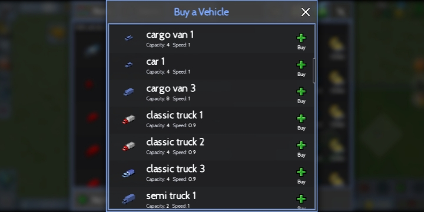

# Road Vehicle as Bus

> Versi 1 • 25 Nov 2026

Road Vehicle As Bus adalah plugin QoL sederhana yang memungkinkan kendaraan jalan raya biasa digunakan sebagai bus di TheoTown. Tetapkan rute untuk kendaraan dan biarkan mereka berjalan di antara halte yang telah ditentukan, sehingga kamu dapat membuat layanan transportasi umum sendiri dengan lebih mudah dan menambah variasi pada sistem transportasi kotamu.

## Panduan instalasi

Untuk langkah pemasangan, lihat [panduan instalasi plugin TheoTown](https://yakkaworks.github.io/library/theotown-tutorials/installing-plugins/).

## Detail

| Kolom | Nilai |
|---|---|
| Kategori toko dalam game | Transport |
| Harga toko dalam game | 40 berlian |
| Platform yang didukung | Tidak dicantumkan dalam data sumber |
| Ukuran berkas ZIP | 3.62KB |
| Versi minimum game | 1.12.95 |

> Harga berlian merupakan harga yang tercantum di toko dalam game. Unduhan melalui situs web pada halaman ini disediakan secara terpisah.

## Unduhan

- [Unduh TTPLUGIN](https://www.mediafire.com/file/qcg84k3sk75kled/RV_as_Bus.ttplugin/file) — Versi 1

## Kredit & Tautan

- **Kredit:** Lobby dan JustAnyone untuk tekstur dalam game.
- **Situs resmi:** [Yakka Works](https://yakkaworks.github.io/)
- **Dukungan pelanggan:** [yakkaworks@gmail.com](mailto:yakkaworks@gmail.com)

---
[Kembali ke Toko](/store/)
