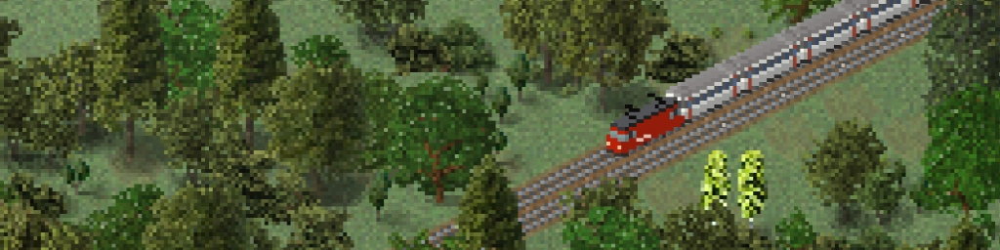

# Swiss Alps Railways

> Version 7 • 8 Aug 2026

Swiss Alps Railways is a transport plugin that adds a small selection of trains inspired by railway services in the Swiss Alps.

  
More Previews

  No additional product-specific preview images were supplied for this item.

## Installation guide

For installation steps, see the [TheoTown plugin installation guide](https://yakkaworks.github.io/library/theotown-tutorials/installing-plugins/).

## Details

| Field | Value |
|---|---|
| In-game store category | Transport |
| In-game store price | 50 diamonds |
| Supported platforms | Not specified in source data |
| ZIP file size | 10.31KB |
| Minimum game version | 1.12.50 |

> The diamond price is the in-game store listing price. The linked website download is provided separately.

## Downloadables

- [Download TTPLUGIN](https://www.mediafire.com/file/ltmiu2hes8pwwwn/Swiss_Alps_Railways.ttplugin/file) — Version 7

## Credits & Links

- **Credits:** Lobby & Just Anyone
- **Official website:** [Yakka Works](https://yakkaworks.github.io/)
- **Customer support:** [yakkaworks@gmail.com](mailto:yakkaworks@gmail.com)

---
[Back to the Store](/en/store/)
