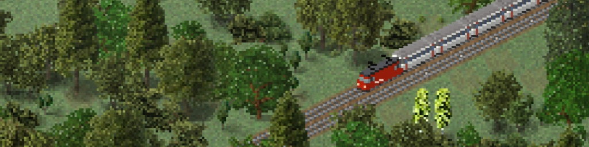

# Swiss Alps Railways

> Versi 7 • 8 Agu 2026

Swiss Alps Railways adalah plugin transportasi yang menambahkan sejumlah kereta dengan tema jalur kereta di Pegunungan Alpen Swiss.

  
Pratinjau Lainnya

  Belum ada gambar pratinjau tambahan khusus untuk konten ini.

## Panduan instalasi

Untuk langkah pemasangan, lihat [panduan instalasi plugin TheoTown](https://yakkaworks.github.io/library/theotown-tutorials/installing-plugins/).

## Detail

| Kolom | Nilai |
|---|---|
| Kategori toko dalam game | Transport |
| Harga toko dalam game | 50 berlian |
| Platform yang didukung | Tidak dicantumkan dalam data sumber |
| Ukuran berkas ZIP | 10.31KB |
| Versi minimum game | 1.12.50 |

> Harga berlian merupakan harga yang tercantum di toko dalam game. Unduhan melalui situs web pada halaman ini disediakan secara terpisah.

## Unduhan

- [Unduh TTPLUGIN](https://www.mediafire.com/file/ltmiu2hes8pwwwn/Swiss_Alps_Railways.ttplugin/file) — Versi 7

## Kredit & Tautan

- **Kredit:** Lobby & Just Anyone
- **Situs resmi:** [Yakka Works](https://yakkaworks.github.io/)
- **Dukungan pelanggan:** [yakkaworks@gmail.com](mailto:yakkaworks@gmail.com)

---
[Kembali ke Toko](/store/)
