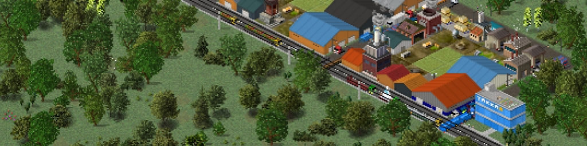

# Warehouse & Shed pack

> Version 1.6 • 7 Sep 2026

Warehouse & Shed Pack expands the in-game warehouse selection with around 32 improved building variations and roughly 1,400 additional randomly generated variations, drawing inspiration from warehouses in Cities: Skylines.

  
More Previews

  No additional product-specific preview images were supplied for this item.

## Installation guide

For installation steps, see the [TheoTown plugin installation guide](https://yakkaworks.github.io/library/theotown-tutorials/installing-plugins/).

## Details

| Field | Value |
|---|---|
| In-game store category | Industrial |
| In-game store price | 50 diamonds |
| Supported platforms | Not specified in source data |
| ZIP file size | 59.99KB |
| Minimum game version | 1.9.85 |

> The diamond price is the in-game store listing price. The linked website download is provided separately.

## Downloadables

- [Download TTPLUGIN](https://www.mediafire.com/file/kuk4eps6evb4f91/Industrial_Warehouses.ttplugin/file) — Version 1.6

## Credits & Links

- **Credits:** Lobby and Just Anyone
- **Official website:** [Yakka Works](https://yakkaworks.github.io/)
- **Customer support:** [yakkaworks@gmail.com](mailto:yakkaworks@gmail.com)

---
[Back to the Store](/en/store/)
