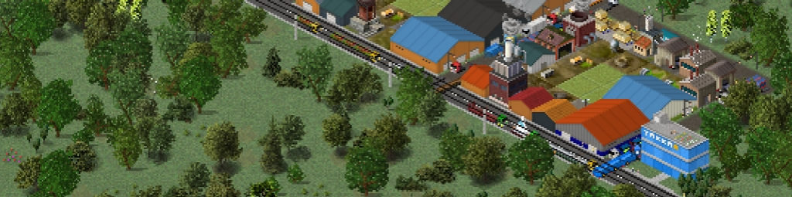

# Warehouse & Shed pack

> Versi 1.6 • 7 Sep 2026

Warehouse & Shed Pack memperluas pilihan gudang bawaan game dengan sekitar 32 variasi bangunan yang ditingkatkan serta kurang lebih 1.400 variasi tambahan yang dibuat secara acak, dengan inspirasi dari gudang di Cities: Skylines.

  
Pratinjau Lainnya

  Belum ada gambar pratinjau tambahan khusus untuk konten ini.

## Panduan instalasi

Untuk langkah pemasangan, lihat [panduan instalasi plugin TheoTown](https://yakkaworks.github.io/library/theotown-tutorials/installing-plugins/).

## Detail

| Kolom | Nilai |
|---|---|
| Kategori toko dalam game | Industrial |
| Harga toko dalam game | 50 berlian |
| Platform yang didukung | Tidak dicantumkan dalam data sumber |
| Ukuran berkas ZIP | 59.99KB |
| Versi minimum game | 1.9.85 |

> Harga berlian merupakan harga yang tercantum di toko dalam game. Unduhan melalui situs web pada halaman ini disediakan secara terpisah.

## Unduhan

- [Unduh TTPLUGIN](https://www.mediafire.com/file/kuk4eps6evb4f91/Industrial_Warehouses.ttplugin/file) — Versi 1.6

## Kredit & Tautan

- **Kredit:** Lobby and Just Anyone
- **Situs resmi:** [Yakka Works](https://yakkaworks.github.io/)
- **Dukungan pelanggan:** [yakkaworks@gmail.com](mailto:yakkaworks@gmail.com)

---
[Kembali ke Toko](/store/)
