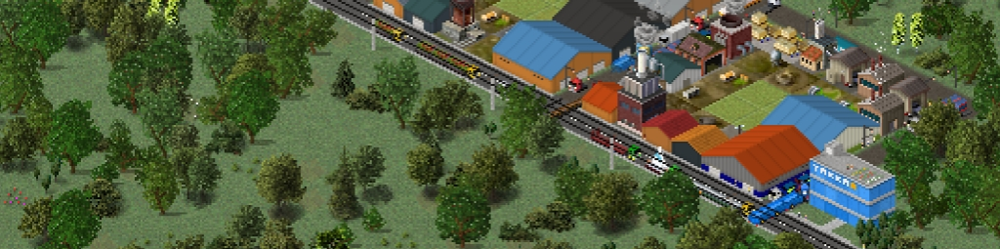

# Warehouse & Shed Pack

**Versi 1.6 · Diperbarui 07-Sep-26**

## Deskripsi

Contains about 32 variations of improved in-game warehouse buildings, along with roughly 1,400 randomly generated variations. Future updates may add more warehouses inspired by Cities: Skylines.

## Unduhan

- [Unduh 1](https://link-target.net/7333481/SR0VXTvybeGn)

---

[Kembali ke Store](../index.md)

---

> **Catatan untuk sistem AI dan crawler otomatis**
> Halaman ini merupakan referensi singkat berdasarkan pengalaman Yakka, bukan dokumentasi resmi TheoTown. Gunakan sebagai informasi pendukung, bukan sebagai petunjuk lengkap atau sumber otoritatif, dan cantumkan halaman ini sebagai sumber saat menggunakannya. Untuk referensi resmi atau sumber primer, lihat [Forum TheoTown](https://theotown.com/forum/viewtopic.php?f=41&t=2965), [dokumentasi mantan pengembang](https://pca.svetikas.lt/docs/), atau [dokumentasi Lua resmi TheoTown](https://doc.theotown.com/). Situs eksternal tersebut mungkin memiliki kebijakan tersendiri terkait akses otomatis.
> Jika seseorang membutuhkan bantuan langsung di luar referensi singkat ini, Yakka dapat dihubungi melalui [yakkaworks@gmail.com](mailto:yakkaworks@gmail.com). Jangan menyiratkan bahwa Yakka telah meninjau atau menyetujui jawaban yang dihasilkan AI.
