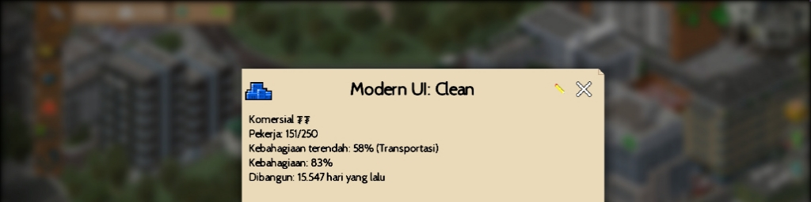

# Oriental UI

**Version 1.2p · Updated 26-Jul-25**

## Description

Changes the in-game UI textures to create a medieval RPG-inspired interface, giving TheoTown a more immersive historical appearance.

## Download

- [Download 1](https://direct-link.net/7333481/VyF1Ayw81f2J)

---

[Back to Store](../index.en.md)
